# DocsBot — an AI support chatbot trained on your website and documents

DocsBot is a multi-tenant RAG (retrieval-augmented generation) SaaS. Point it at a website, upload PDFs or paste FAQs, and it answers customer questions **with citations to the exact page**, **declines when the answer isn't in your content**, and **collects the visitor's email** for your team when it can't help. You embed it on any site with one `<script>` tag.

It is built as a production-minded v1: real auth, Postgres + pgvector, streaming, provider fallback, rate limiting, an SSRF-safe crawler, a CSP-locked widget, analytics and cost tracking, and tests at every level.

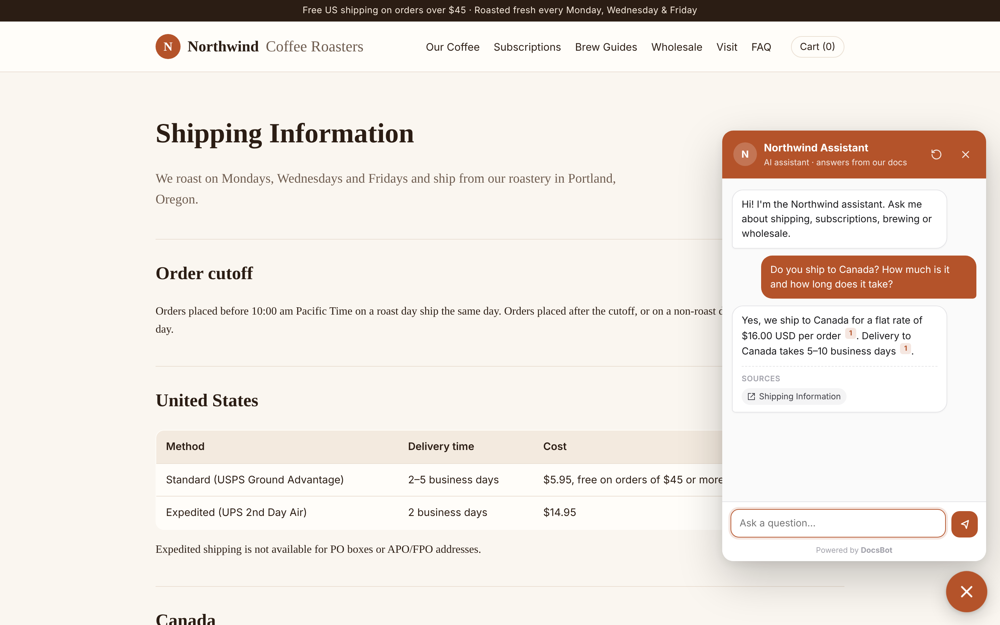

> The demo customer is **Northwind Coffee Roasters**, a fictional small business whose website and wholesale PDF ship with the repo as test fixtures. Every answer and number in these screenshots came from live runs against Gemini.

## Contents

- [Features](#features)
- [Screenshots](#screenshots)
- [Architecture](#architecture)
- [Quick start](#quick-start)
- [Configuration](#configuration)
- [Testing](#testing)
- [Deployment](#deployment)
- [Cost notes](#cost-notes)
- [Security notes](#security-notes)
- [Limitations and roadmap](#limitations-and-roadmap)

## Features

**Knowledge sources**
- **Website crawl**: seeds from `sitemap.xml` (via robots.txt `Sitemap:` or `/sitemap.xml`) plus the start URL, follows same-origin links breadth-first, and stops at a page limit. It respects `robots.txt` (Allow/Disallow with wildcards, Crawl-delay), `<meta name="robots" content="noindex|nofollow">` and `rel="nofollow"`, removes duplicate pages, and follows redirects only within the same site.
- **HTML → clean text**: keeps `main`/`article` content as Markdown-like text (headings, lists, tables, image alt text) and drops nav, header, footer, scripts, forms and cookie banners.
- **PDF upload**: text is extracted per page (pdf.js via `unpdf`, no native dependencies), so answers cite "Guide, page 3".
- **Pasted text / FAQ**: Markdown headings become section context.
- **Heading-aware chunking**: sections are kept together, long sections are split on paragraph and sentence boundaries with overlap, and every chunk is embedded with its `Document title › Section › Subsection` trail.
- **Re-sync** any source. The new version replaces the old one in a single transaction, so the bot keeps answering during a re-sync. Chunks that haven't changed reuse their stored embeddings, so a re-sync only pays for what changed.
- **Ingestion status** in the UI: queued → crawling (pages fetched) → embedding (n/N) → ready, or failed with a readable error.

**Answering**
- **Hybrid retrieval**: pgvector HNSW cosine search plus Postgres full-text search, fused with Reciprocal Rank Fusion.
- **Grounded prompt**: the model may use only the numbered passages, must cite them inline (`[1]`), and must never invent prices or policies. Passages are fenced as data to resist prompt injection, and the owner's tone instructions cannot override these rules.
- **Two layers of "I don't know"**:
  1. A per-bot **confidence threshold** on the best vector match. Below it the bot declines without calling the LLM at all, which also saves cost.
  2. A `NO_ANSWER` sentinel that the model must return when the passages don't contain the answer. It is detected while streaming and never shown to the visitor.
- **Streaming** over Server-Sent Events, rendered by a small, safe Markdown renderer with clickable citation markers and source chips.
- **Follow-ups**: short or referential questions ("and how long does it take?") are also searched together with the previous question, in the same embedding call.
- **Lead capture**: when the bot can't answer, or the visitor asks for a person, an inline form collects their email and question. Leads appear in the dashboard and can be exported as CSV.

**AI providers**
- An **OpenAI-compatible client** that works with both OpenAI and Gemini (Google's OpenAI-compatible endpoint), plus **Anthropic Claude** via the official SDK.
- A **fallback chain**: the bot's model first, then `CHAT_FALLBACK_MODELS`. Each step retries 429/5xx/timeouts with capped exponential backoff and jitter, honouring `Retry-After`; other 4xx errors skip straight to the next provider. A **circuit breaker** skips a model for a while after it has been rate-limited.
- **Embeddings** from Gemini (`gemini-embedding-001`) or OpenAI (`text-embedding-3-small`), always 1536 dimensions. The returned width is verified, and each vector records the model that produced it. Retrieval never compares vectors from different models, and the dashboard asks for a re-sync if you switch embedding models.

**Dashboard**
- Email/password accounts. Each user gets a workspace with multiple bots.
- Per-bot settings: name, welcome and fallback messages, brand color, instructions/tone, chat model, temperature, confidence threshold, passages per answer, allowed domains, and lead capture on/off.
- Analytics: conversations per day, answer rate, unanswered questions (your knowledge gaps), top questions, leads, and **token usage with estimated cost per model**.
- Conversation logs show each answer's citations, similarity score, model, tokens and latency.
- A playground that is literally the production widget, and an install page with the snippet and an HTTP API example.

**Embeddable widget**
- `<script src="https://APP/widget.js" data-bot-id="…" async></script>`: about 2 KB gzipped, with no dependencies. It renders a floating bubble in a Shadow DOM and lazily opens the chat in an iframe.
- **Allowed domains** are enforced by the browser through the iframe's `Content-Security-Policy: frame-ancestors`, and the config endpoint refuses other origins.
- There is also a shareable full-page chat at `/embed/<botId>?mode=standalone`.

## Screenshots

| | |
|---|---|
| **Landing page** 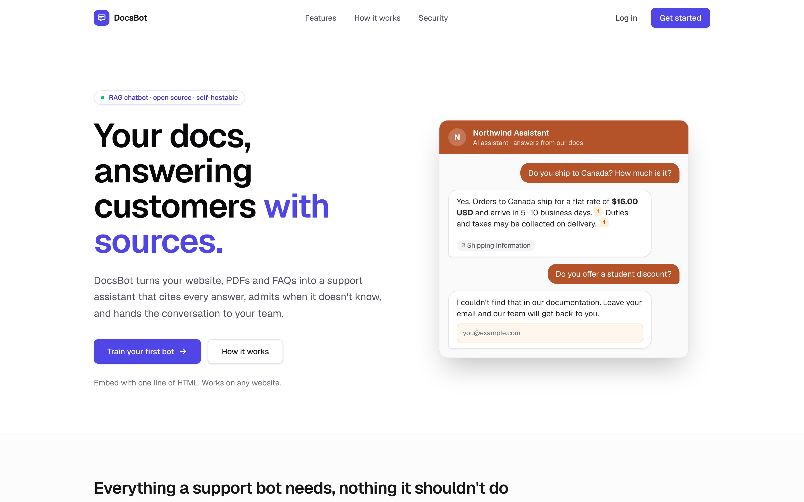 | **Analytics, gaps and cost** 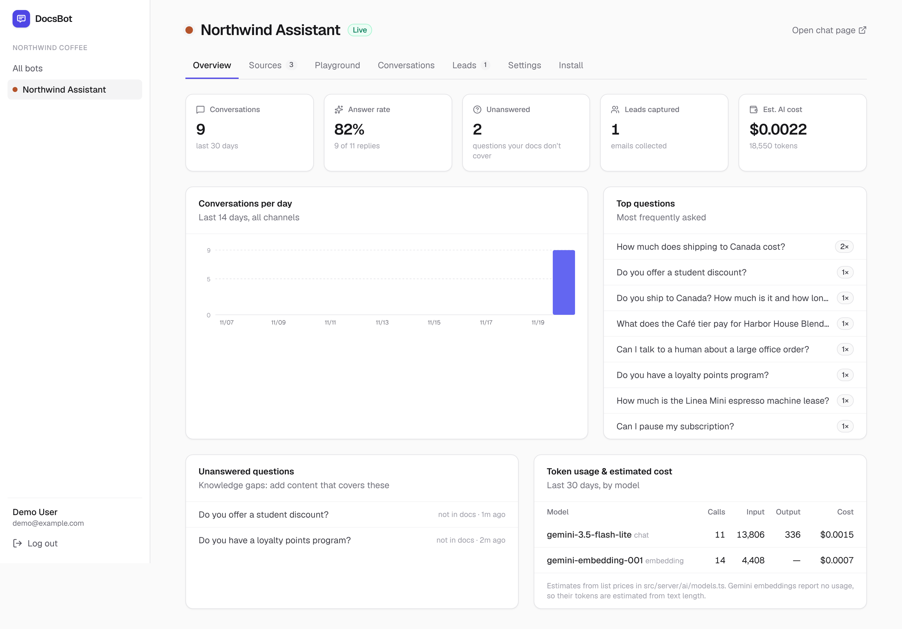 |
| **Sources and ingestion status** 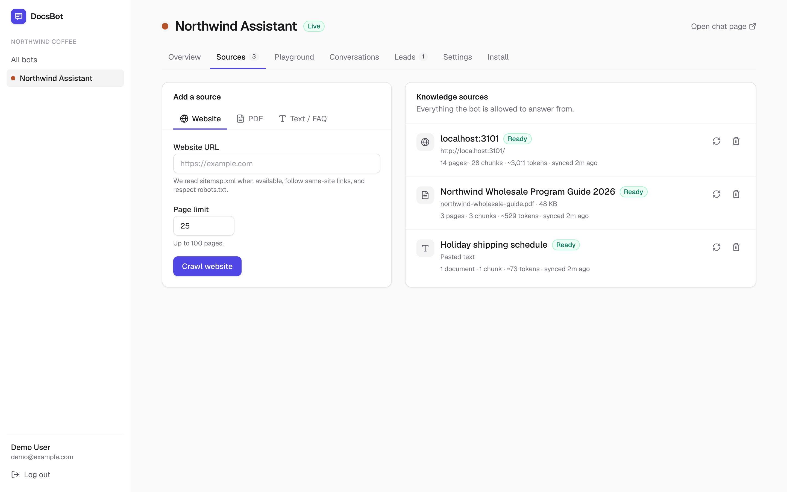 | **Playground: answer with PDF page citations** 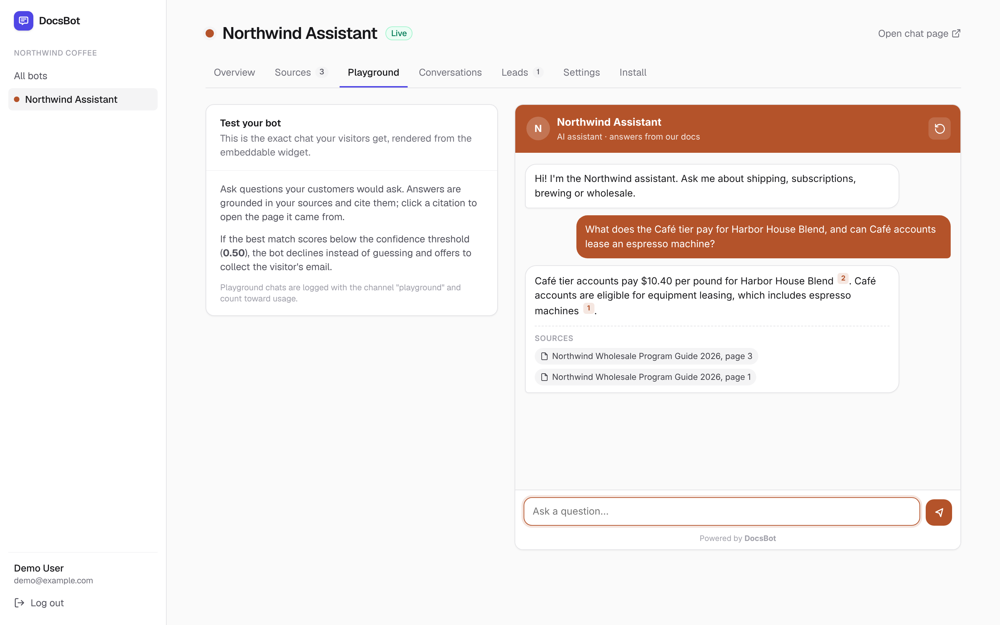 |
| **Widget on the customer site**  | **Declines and offers lead capture** 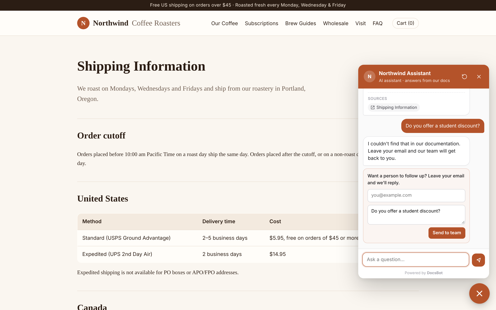 |
| **Leads** 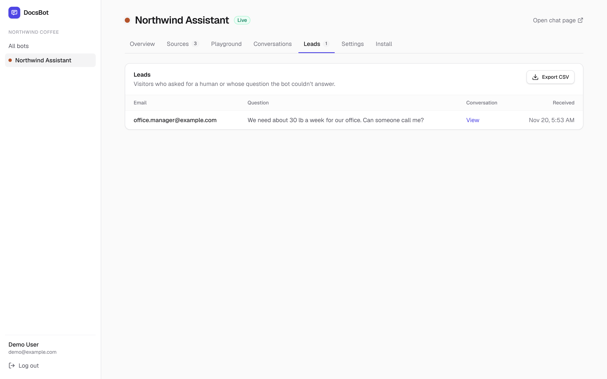 | **Conversation log with metadata** 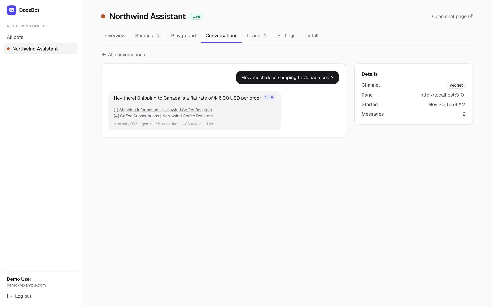 |
| **Bot settings** 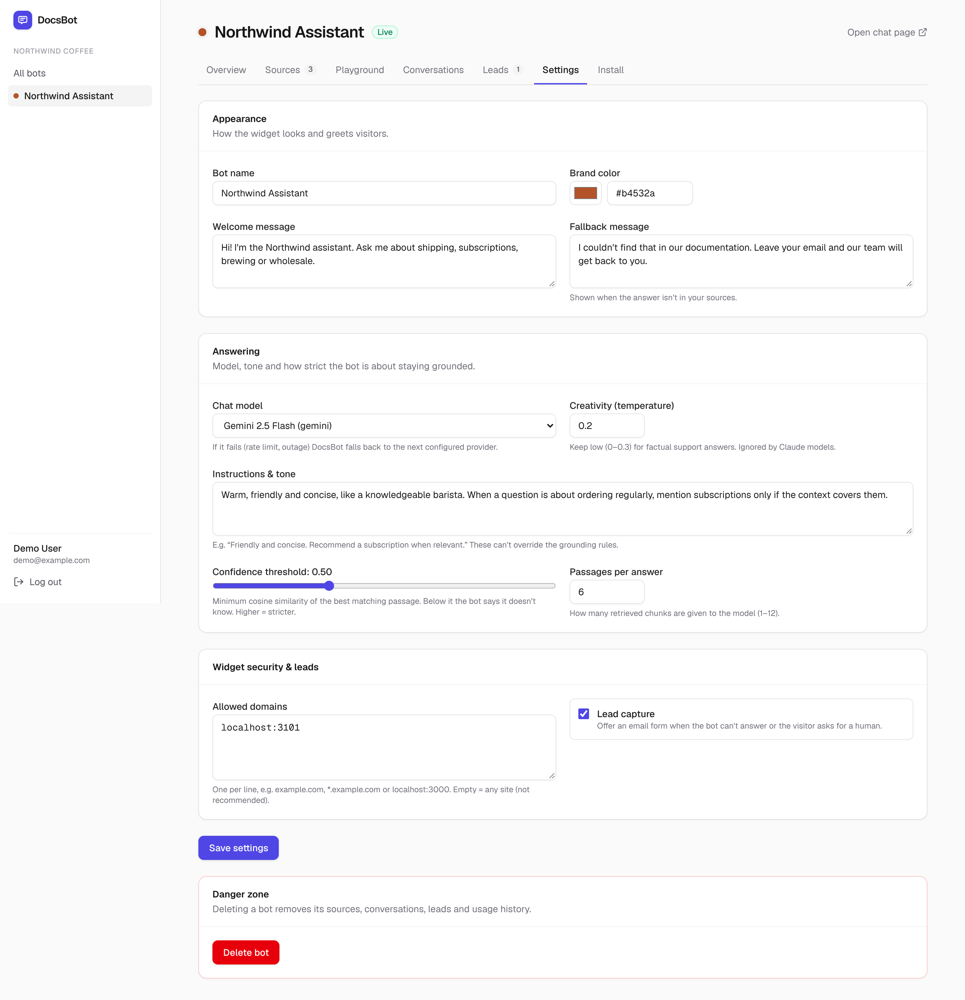 | **Install snippet** 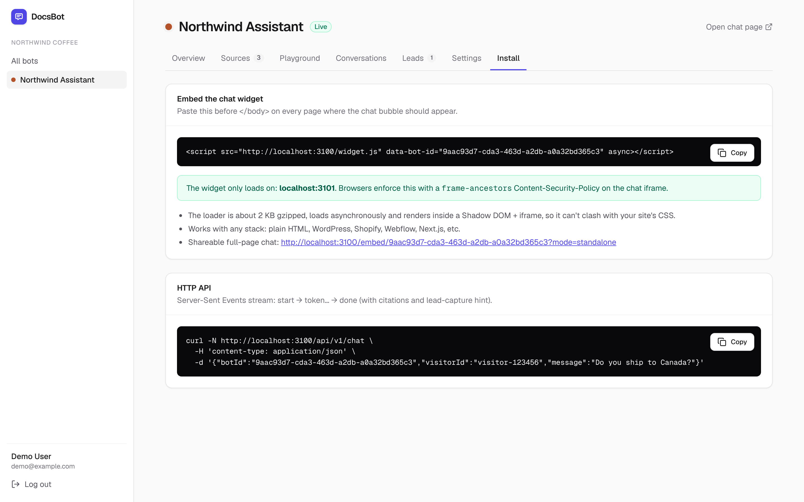 |

## Architecture

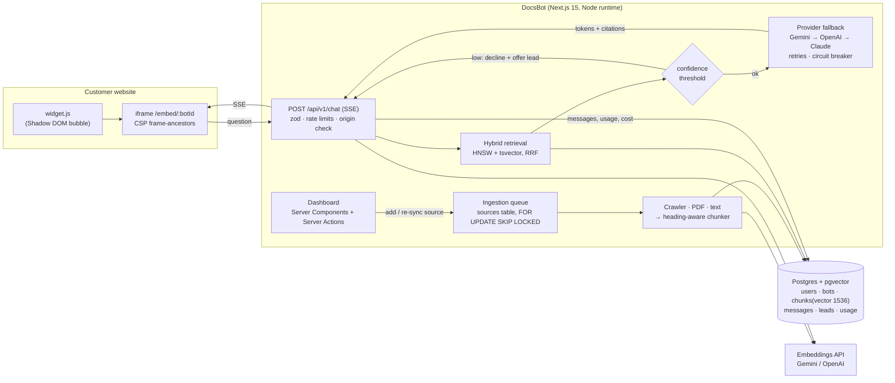

**Life of a question**: the widget posts to `/api/v1/chat`. The request is validated with zod, rate-limited per IP and per bot (Postgres-backed counters that also work on serverless), and checked against the bot's allowed domains. Then the server:

1. embeds the question (and, for follow-ups, the question together with the previous turn);
2. runs vector and keyword search and fuses the results;
3. declines immediately if the best similarity is below the bot's threshold;
4. otherwise streams the answer from the first healthy provider, holding back the first characters to detect `NO_ANSWER`;
5. extracts citations and strips invalid markers;
6. stores the message, tokens and estimated cost, and tells the widget whether to offer lead capture.

**Database drivers**: production uses `postgres-js` against any Postgres with pgvector. For zero-setup local development and tests, `DATABASE_URL=pglite://…` runs the same schema and the same SQL on [PGlite](https://pglite.dev), a WASM Postgres with the pgvector extension. Migrations are managed by Drizzle and apply to both.

```
src/
  app/                 Next.js routes: landing, auth, dashboard, /embed, /api/v1/*
  server/
    ai/                OpenAI-compatible + Anthropic providers, fallback, embeddings, model catalog/pricing
    ingest/            crawler, robots.txt, HTML extraction, PDF, chunker, SSRF guard, pipeline + queue
    rag/               retrieval (hybrid + RRF), prompt building, answer orchestration
    db/                Drizzle schema and dual-driver client
    auth/              scrypt passwords, DB-backed sessions
    ratelimit.ts, domains.ts, env.ts, logger.ts, validation.ts
  widget/              embeddable loader + iframe chat app (bundled with esbuild)
  shared/              SSE parser, safe Markdown renderer (used by server, dashboard and widget)
fixtures/northwind/    fictional coffee-roaster website, wholesale PDF, local server
tests/                 unit (vitest), integration (live AI), e2e (Playwright)
```

## Quick start

Requirements: Node 20.11+ (22 recommended), pnpm 10, and an API key for Gemini **or** OpenAI (Anthropic is optional as a chat fallback). No database is needed for local use.

```bash
pnpm install
cp .env.example .env      # set GEMINI_API_KEY (free tier works) or OPENAI_API_KEY
pnpm demo                 # seeds the demo, builds, starts everything
```

`pnpm demo` crawls the bundled Northwind site, embeds it, and starts:

| | URL | |
|---|---|---|
| DocsBot dashboard | http://localhost:3100/login | `demo@example.com` / `demo-password` |
| Demo customer site with the widget | http://localhost:3101 | chat bubble in the bottom-right corner |

Useful commands:

```bash
pnpm demo --reset      # re-create the demo account and re-ingest
pnpm dev               # Next.js dev server on :3100 (sign up and create your own bots)
pnpm fixture           # serve only the Northwind demo site on :3101
pnpm seed              # seed the demo bot (with PGlite, run while the app is stopped)
pnpm screenshots       # regenerate docs/screenshots from a running demo
```

To try your own site in development, create a bot, add your URL on the **Sources** tab, then open the **Playground**. Crawling `localhost` requires `CRAWLER_ALLOW_PRIVATE_NETWORKS=true` (dev only).

> Behind an HTTP proxy? Node's `fetch` ignores `HTTPS_PROXY` unless `NODE_USE_ENV_PROXY=1` is set (Node ≥ 22.21). `pnpm demo` sets it automatically when a proxy is configured.

## Configuration

All variables are validated with zod at startup (`src/server/env.ts`). See `.env.example` for a commented template.

| Variable | Default | Description |
|---|---|---|
| `APP_URL` | `http://localhost:3100` | Public URL; used in the embed snippet and for secure cookies (`https://` → `Secure`) |
| `DATABASE_URL` | `pglite://.data/pglite` | `postgres://…` in production; `pglite://<dir>` or `pglite://memory` for local/tests |
| `DATABASE_PREPARE` | `true` | Set `false` for pgbouncer transaction poolers (Supabase/Neon pooled URLs) |
| `DATABASE_POOL_SIZE` | `10` | postgres-js pool size |
| `DB_AUTO_MIGRATE` | `true` | Auto-apply migrations on first connection (PGlite only) |
| `GEMINI_API_KEY` | — | Enables Gemini chat models and Gemini embeddings |
| `GEMINI_BASE_URL` | Google's `/v1beta/openai/` | OpenAI-compatible Gemini endpoint |
| `OPENAI_API_KEY` | — | Enables OpenAI chat models and embeddings |
| `OPENAI_BASE_URL` | `https://api.openai.com/v1/` | Any OpenAI-compatible gateway works |
| `ANTHROPIC_API_KEY` | — | Enables Claude models (chat only) |
| `DEFAULT_CHAT_MODEL` | `gemini-2.5-flash` | Model for new bots (falls back to any configured provider) |
| `CHAT_FALLBACK_MODELS` | `gemini-3.5-flash-lite,gpt-4o-mini,claude-haiku-5-5` | Tried in order after the bot's model fails; models without a key are skipped |
| `EMBEDDING_PROVIDER` | `gemini` if its key is set, else `openai` | Embedding provider |
| `EMBEDDING_MODEL` | provider default | `gemini-embedding-001` / `text-embedding-3-small`; must support 1536 dims |
| `AI_TIMEOUT_MS` | `30000` | First-byte and stream-idle timeout |
| `AI_MAX_RETRIES` | `2` | Retries per model before falling back |
| `CRAWLER_ALLOW_PRIVATE_NETWORKS` | `false` | Allow crawling localhost/private IPs. **Never enable in production** |
| `CRAWLER_MAX_PAGES` | `100` | Upper bound for any website source |
| `CRAWLER_TIMEOUT_MS` | `10000` | Per-request crawl timeout |
| `MAX_UPLOAD_MB` | `10` | PDF size limit |
| `INGEST_WORKER` | `inline` | `inline`: process the queue in the web server; `off`: only via the cron endpoint |
| `CRON_SECRET` | — | Bearer token for `GET/POST /api/cron/ingest` |
| `RATE_LIMIT_CHAT_PER_IP_PER_MINUTE` | `20` | Public chat limit per client IP |
| `RATE_LIMIT_CHAT_PER_BOT_PER_HOUR` | `600` | Public chat limit per bot (caps spend from abuse) |
| `MAX_MESSAGE_CHARS` | `2000` | Maximum question length |
| `TRUST_PROXY` | `true` | Use `X-Forwarded-For` for the client IP (disable if not behind a proxy you control) |
| `LOG_LEVEL` / `LOG_FORMAT` | `info` / pretty in dev | Logs are JSON lines in production or with `LOG_FORMAT=json` |

## Testing

```bash
pnpm lint && pnpm typecheck
pnpm test                 # 104 unit tests, no network; DB tests run on in-memory PGlite
TEST_DATABASE_URL=postgres://… pnpm test   # the same tests on a real Postgres + pgvector
pnpm test:integration     # live AI: crawl fixture site + PDF → embed → ask → check answers & citations
pnpm build && pnpm test:e2e   # Playwright: signup → bot → ingest → playground → leads → widget on external site
```

- **Unit** (vitest): chunker, HTML extraction, robots.txt, crawler (against the local fixture server), retrieval fusion and threshold logic, pgvector queries, prompt building and the `NO_ANSWER` gate, citation extraction, rate limiter (memory and Postgres), provider clients with mocked HTTP (OpenAI-compatible SSE, the Anthropic SDK, embeddings), fallback, backoff and the circuit breaker, the answer orchestrator, SSRF guard, domain matching/CSP, password hashing, the Markdown renderer's XSS escaping, and env validation.
- **Integration**: real embeddings and chat (the cheapest Gemini model). It checks a page-specific answer cited to `/shipping`, a PDF answer cited to page 1, a deep-page detail, a refusal with lead offer, that robots-disallowed content never leaks, and usage accounting. It skips itself when no key is set.
- **E2E**: Playwright against a production build on a fresh database, including the widget on `localhost:3101` and refusal on the non-allowed origin `127.0.0.1:3101`.

CI (`.github/workflows/ci.yml`) runs lint, typecheck, unit tests on both PGlite and a `pgvector/pgvector:pg16` service, migrations and the build. The live tests run when a `GEMINI_API_KEY` or `OPENAI_API_KEY` secret is present.

## Deployment

### Vercel + Neon or Supabase

1. Create a Postgres database and enable pgvector: on Neon or Supabase, run `CREATE EXTENSION IF NOT EXISTS vector;` (the first migration also does this if your role is allowed to).
2. Apply migrations from your machine or a CI step: `DATABASE_URL=postgres://… pnpm db:migrate`.
3. Import the repo into Vercel. Set `DATABASE_URL` (for a pooled pgbouncer URL also set `DATABASE_PREPARE=false`), `APP_URL`, your provider keys and `CRON_SECRET`.
4. Ingestion starts right after a source is added (via `next/server` `after()`). To pick up anything interrupted, schedule a Vercel Cron (or any scheduler) to call `GET /api/cron/ingest` with `Authorization: Bearer $CRON_SECRET`, and set `INGEST_WORKER=off`. Large crawls are bounded by your plan's function duration; use the Docker option for very large sites.

### Docker on a VPS

```bash
cp .env.example .env    # provider keys, APP_URL=https://chat.yourdomain.com
docker compose up -d --build
```

The compose file runs the app (Next.js standalone server; migrations apply on start) and `pgvector/pgvector:pg16` with a persistent volume. Put a TLS-terminating reverse proxy (Caddy, Nginx, Traefik) in front of port 3100.

> **Not verified:** the Dockerfile and compose file were written carefully but could not be built in the sandbox this project was developed in (no Docker daemon). What *was* verified there: the same standalone build (`NEXT_OUTPUT=standalone`) and the bundled migration runner (`pnpm build:migrate`), running against Postgres 16 + pgvector, answering live questions with citations.

## Cost notes

Measured on the Northwind demo with the list prices in `src/server/ai/models.ts` (estimates; check your provider's pricing page):

- **Ingestion**: the 14-page site, the 3-page PDF and an FAQ come to about 32 chunks and about 4k tokens. With `gemini-embedding-001` ($0.15/M) that is roughly **$0.0006** per full sync. Re-syncs re-embed only changed chunks.
- **Per answer**: about 1,000–1,100 input tokens (system prompt + up to 6 passages) and 30–80 output tokens. That is about **$0.0004** on `gemini-2.5-flash` and about **$0.0001** on a flash-lite class model, plus a tiny query embedding.
- **Declined questions are cheap**: below the threshold no LLM call is made.
- The dashboard shows usage and estimated cost per bot and model. Gemini's OpenAI-compatible embeddings endpoint reports no token usage, so those tokens are estimated from text length (and flagged as estimated in the database).
- Free-tier Gemini keys hit 429s quickly. The fallback chain plus circuit breaker keeps answering on another model; this happened during development and is visible in the logs.

## Security notes

- **Passwords**: scrypt (N=2^15, per-user salt) with a timing-equalised login path. Login is rate-limited per IP and per email; sign-up is rate-limited per IP.
- **Sessions**: 256-bit random tokens in an `httpOnly`, `SameSite=Lax` cookie (also `Secure` when `APP_URL` is https). Only the SHA-256 of a token is stored. Sessions expire and slide, and every dashboard query is scoped to the user's workspace. Server Actions get Next.js's built-in Origin check.
- **SSRF**: crawl URLs must be http(s) without credentials. Hostnames are resolved with a guarded DNS lookup *at connect time*, which rejects loopback, private, link-local (cloud metadata) and CGNAT ranges and also defeats DNS rebinding. Every redirect hop is re-validated.
- **Widget**: the chat iframe sends `Content-Security-Policy: frame-ancestors <allowed domains>` with a strict `default-src 'none'`. The rest of the app sends `frame-ancestors 'none'` and `X-Frame-Options: DENY`. Allowed domains are a browser-level control, not authentication: a script can call the public API directly with a spoofed `Origin`, which is why the per-IP and per-bot rate limits and the message-length limit exist.
- **Prompt injection**: retrieved text is fenced and declared as data, the rules come after the owner's instructions, and the model output is rendered through an escaping Markdown renderer. Links are only created for citation URLs from our own index.
- **Input handling**: zod validation on every request and form, body size limits, PDF magic-number checks, and CSV export escaping against formula injection. Secrets come only from env vars.

## Limitations and roadmap

These are honest gaps in v1:

- **JavaScript-rendered sites**: the crawler reads server-rendered HTML only (no headless browser), so client-only SPAs extract little text.
- **Scanned PDFs** need OCR, which isn't implemented. DOCX/Notion/Google Docs connectors aren't implemented either.
- **Teams and billing**: one owner per workspace, no invitations or roles, no plans or Stripe.
- **Lead notifications**: leads are listed in the dashboard and exportable as CSV, but there are no email or Slack notifications yet.
- **Background jobs** run in-process (or via cron/`after()` on serverless). Very large crawls would benefit from a dedicated worker or queue.
- **Scale**: one HNSW index serves all tenants, filtered by bot. For many large tenants, use pgvector ≥ 0.8 iterative index scans, partial indexes or partitioning.
- **Streaming fallback** can only switch provider before the first token. A mid-stream failure ends that answer with an error note.
- **Anthropic** is covered by unit tests with mocked HTTP through the official SDK, but was not exercised live (no key in the development environment). OpenAI likewise was only tested with mocks; Gemini was tested live.
- **Pricing** is a static table, and `gemini-3.5-flash-lite` uses an assumed price.
- **Language**: full-text search uses the `english` configuration. Vector search works in any language the embedding model supports.

Roadmap ideas: email/Slack lead alerts, scheduled re-syncs, a JS-rendering crawler, team workspaces, answer feedback (thumbs up/down) feeding the gap report, and a conversation export API.

---

Built by Cuong Nguyen — full stack & AI developer. Available for hire on Fiverr: https://www.fiverr.com/cuongnqxx
